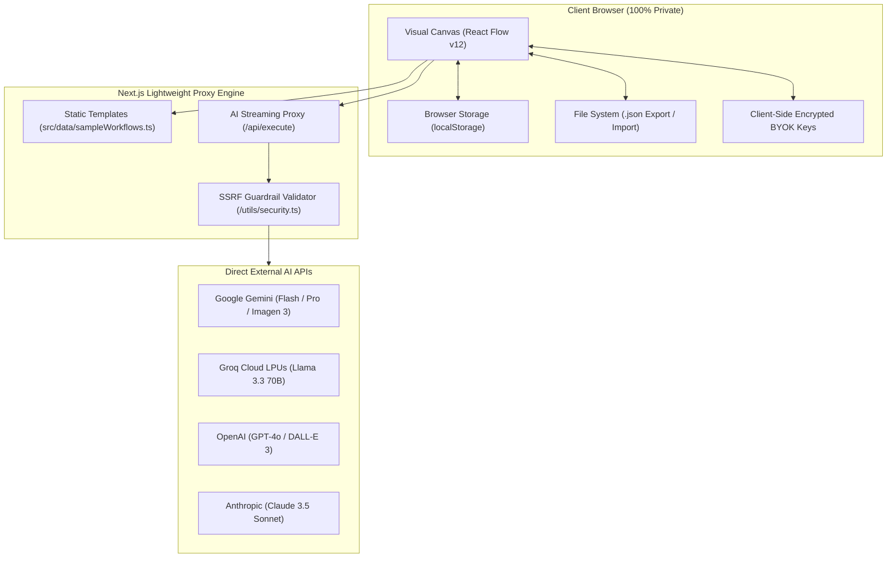

# ⚡ PF Studio — Modern Visual AI Workflow Builder & Prompt Engineering IDE

<div align="center">

[](LICENSE)
[](https://nextjs.org)
[](https://react.dev)
[](https://reactflow.dev)
[](#-local-first-architecture)
[](#-local-first-architecture)
[](https://www.typescriptlang.org)
[](https://github.com/RaadDev/pf-studio/pulls)

<p align="center">
  <b>The open-source visual IDE for designing, executing, and automating production-grade AI prompt chains, multi-modal pipelines, and autonomous workflows.</b><br>
  Built with a <b>100% Local-First Architecture</b> — Zero Cloud Dependencies, Zero Database Setup, Instant Plug & Play.
</p>

[English Overview](#-english-overview) • [دليل الاستخدام بالعربية](#-دليل-الاستخدام-والتوثيق-الشامل-بالعربية) • [Quick Start](#-quick-start) • [Architecture](#-local-first-architecture) • [Project Structure](#-project-structure) • [Nodes Catalog](#-complete-20-nodes-catalog) • [AI Models Matrix](#-supported-ai-models-matrix) • [Extensibility](#-developer-guide-create-a-custom-node) • [FAQ](#-frequently-asked-questions)

</div>

---

## 🌟 Key Capabilities at a Glance

* 🔒 **100% Local-First & Zero-Cloud:** All graphs, prompt configs, execution logs, and credentials reside exclusively in the client's browser (`localStorage` / JSON Export). Zero cloud databases, zero login barriers, zero recurring hosting fees.
* ⚡ **Instant Plug & Play:** Clone the repository, run `npm run dev`, and begin orchestrating workflows in under 60 seconds with zero backend provisioning.
* 🤖 **Multi-Model Intelligence Hub:** Seamlessly chain **Google Gemini 3.8 Flash** (Default ultra-fast), **Gemini 3.1 Pro Preview**, **Google Imagen 3**, **Meta Llama 3.3 70B via Groq LPUs**, **OpenAI GPT-4o / GPT-4o-mini**, **Claude 3.5 Sonnet**, and **Flux.1**.
* 🧩 **20 Specialized Visual Nodes:** Full-spectrum nodes covering Raw Inputs, Live Web Search, YouTube Transcript Extraction, Real REST APIs, Conditionals, Batch Loops, JSON Schema Enforcement, Audio Synthesis (TTS), and Webhooks.
* 📱 **Instant "App Mode" View:** Transform complex visual graphs into a clean, standalone consumer web application for clients or non-technical team members with one click.
* 🧪 **Automated Testing Lab & A/B Benchmark:** Create regression test suites with output assertions (Strict equality, Regex, Non-empty, Valid JSON) and benchmark model latency side-by-side.
* 🌐 **Native RTL & LTR Auto-Layout:** Topological graph distribution powered by Dagre with native Right-to-Left flow optimized for the Arabic language as well as standard Left-to-Right layout.
* 🛡️ **Enterprise SSRF Protection:** Built-in network guardrails protecting against Server-Side Request Forgery, blocking private subnets, localhost, and cloud metadata endpoints.
* 📊 **5-Tab Observability Console:** Real-time visibility across Logs (السجلات), Outputs (المخرجات), Diagnostics (التشخيص), Inputs (المدخلات), and Performance Latency (الأداء).

---

## 🏛️ Visual Studio Interface Layout

```
┌────────────────────────────────────────────────────────────────────────────────────────┐
│ [PF] PF Studio / [المسار الرئيسي ▼]   [💾 حفظ محلي] [📥 تصدير JSON] [📤 استيراد مسار]  │  ◄── Header & Storage
├────────────────────────────────────────────────────────────────────────────────────────┤
│ ┌──────────────┐   ┌──────────────┐   ┌──────────────┐   ┌──────────────┐              │
│ │  TextInput   │──►│   TextAI     │──►│ ToneRewriter │──►│ FinalResult  │              │  ◄── Visual Canvas
│ │ (Raw Topic)  │   │(Gemini Flash)│   │ (Saudi Voice)│   │ (MD Preview) │              │      (React Flow v12)
│ └──────────────┘   └──────────────┘   └──────────────┘   └──────────────┘              │
│                                                                                        │
│                                [ ✨ اسأل مهندس المسارات الذكي... ]                     │  ◄── Copilot Ask Bar
├────────────────────────────────────────────────────────────────────────────────────────┤
│ [📊 السجلات (Logs)]  [📄 المخرجات (Outputs)]  [🩺 التشخيص]  [📥 المدخلات]  [⏱️ الأداء]  │  ◄── 5-Tab Console
└────────────────────────────────────────────────────────────────────────────────────────┘
```

---

## 🚀 Quick Start

### Prerequisites
* **Node.js** v20.x or v22.x+
* **npm**, **pnpm**, or **yarn**

### 1. Clone & Install
```bash
# Clone the repository
git clone https://github.com/RaadDev/pf-studio.git
cd pf-studio

# Install dependencies
npm install
```

### 2. Configure Environment (Optional but Recommended)
```bash
cp .env.example .env.local
```
Edit `.env.local` with your Google Gemini API key:
```env
# Get your free key at: https://aistudio.google.com/app/apikey
GEMINI_API_KEY="your_gemini_api_key_here"
```
*(You can also input your API keys directly inside the Studio Settings modal in your browser — BYOK: Bring Your Own Keys).*

### 3. Run Development Server
```bash
npm run dev
```
Open **[http://localhost:3000](http://localhost:3000)** in your browser. The canvas is ready to use immediately!

### 4. Build for Production
```bash
npm run build
npm run start
```

---

## 🏛️ Local-First Architecture

PF Studio follows the architectural philosophy of leading privacy-first tools like **Excalidraw**, **ComfyUI**, and **Draw.io**:



---

## 📁 Project Structure

```
pf-studio/
├── src/
│   ├── app/                         # Next.js 16 App Router
│   │   ├── api/execute/route.ts     # High-performance AI Streaming & Execution Proxy
│   │   ├── api/workflows/route.ts   # Static workflow template endpoints
│   │   ├── layout.tsx               # Root layout, Google Fonts & theme providers
│   │   └── page.tsx                 # Main Studio Entry Point
│   ├── components/
│   │   ├── canvas/                  # React Flow Canvas, Minimap & Custom Controls
│   │   ├── nodes/                   # 20 Specialized Visual Workflow Nodes
│   │   │   ├── NodeContainer.tsx    # Unified card layout, handles, and status badges
│   │   │   ├── TextAINode.tsx       # Core LLM node with streaming & magic wand
│   │   │   ├── ToneRewriterNode.tsx # Dialect and voice adapter (Saudi, Khaleeji, etc.)
│   │   │   ├── ImageAINode.tsx      # Imagen 3 & Flux image generator
│   │   │   └── ...                  # 16 other modular node components
│   │   ├── modals/                  # Settings, Templates, Keyboard Shortcuts, App Mode
│   │   ├── testing/                 # Regression Testing Lab & A/B Assertion Matrix
│   │   └── toolbar/                 # Header, Node Library, Output Console, User Badge
│   ├── engine/
│   │   └── executionEngine.ts       # Topological sorting (DAG) & Node execution engine
│   ├── data/
│   │   └── sampleWorkflows.ts       # 25 Pre-built Production Workflow Templates
│   ├── types/
│   │   └── workflow.ts              # Core TypeScript interfaces & state schemas
│   └── utils/
│       ├── localWorkflowStorage.ts  # Local-first localStorage & JSON file manager
│       ├── security.ts              # SSRF guardrails & private IP address blocker
│       ├── dagreLayout.ts           # Native RTL & LTR topological auto-layout
│       └── tts.ts                   # Web Speech API Arabic voice synthesizer
├── public/                          # Static assets, branding, and icons
├── .env.example                     # Sample environment variable template
├── package.json                     # Project manifest and script commands
├── tsconfig.json                    # Strict TypeScript configuration
└── tailwind.config.ts               # Custom color tokens and design system
```

---

## 🧩 Complete 20-Nodes Catalog

PF Studio ships with **20 modular nodes** organized across 6 functional domains:

### 📥 1. Input & Data Acquisition
* **`TextInputNode`**: Entry point for raw prompts, instructions, and seed data. Includes real-time word/character counters, quick presets (Code Review, Marketing Idea, Blog Draft, Financial Numbers, JSON schema), and instant paste.
* **`WebSearchNode`**: Performs live internet intelligence gathering with customizable search queries, engine selection, result count limits, and automatic URL and snippet extraction.
* **`FileUploadNode`**: In-browser document loader supporting `TXT`, `MD`, `CSV`, `JSON`, `TypeScript`, and `Python` with drag-and-drop file inspection and byte-accurate size metrics.
* **`UrlScraperNode`**: High-performance webpage scraper with Cheerio HTML cleaning and automatic **YouTube video transcript extraction** via oEmbed, shielded by SSRF validation.

### 🟣 2. AI Intelligence & Generation
* **`TextAINode`**: Core LLM generation node supporting real-time token streaming, custom system prompts, temperature sliders, generation history reverting, and the **AI Magic Wand** prompt enhancer.
* **`ToneRewriterNode`**: Specialized tone, dialect, and voice adapter: Saudi White (`سعودية بيضاء`), Khaleeji Marketing (`خليجية تسويقية`), Formal Modern Arabic (`فصحى رسمية`), Storytelling (`أسلوب قصصي`), Executive Briefing (`تلخيص تنفيذي`), and Sales Copy.
* **`ImageAINode`**: Photorealistic and artistic digital imagery synthesis powered by Google Imagen 3, Flux.1 Schnell/Pro, and DALL-E 3 with multi-aspect ratio selection (`1:1`, `16:9`, `9:16`).
* **`StructuredOutputNode`**: Enforces strict `JSON Schema` conformity. Guarantees deterministic, machine-readable outputs for database ingestion or API consumption.

### ⚙️ 3. Logic, Batch & Flow Control
* **`JsonExtractorNode`**: Parses incoming unstructured text and extracts designated schema fields into indexed, syntax-highlighted JSON objects.
* **`SplitterNode`**: Deconstructs large documents or datasets into manageable chunks by line (`\n`), paragraph (`\n\n`), comma, or custom regular expressions.
* **`BatchLoopNode`**: Iterative execution engine that steps through list elements sequentially with index tracking and manual next/previous controls.
* **`ConditionalNode`**: Branching router (`If / Else`) that evaluates content containment, word counts, or character thresholds, exposing dual output handles (`True` / `False`).
* **`TemplateMergeNode`**: Variable-driven interpolation engine that injects upstream node outputs into customizable template strings using `{{input_1}}` and `{{input_2}}` with reactive auto-sync.
* **`DelayNode`**: Flow regulator featuring an interactive countdown timer (1s, 2s, 5s, 10s, 30s presets) to manage API rate limits and execution sequencing.

### 🧪 4. Testing, Documentation & Media
* **`TestAssertionNode`**: Automated test assertion checker verifying output conditions: Not Empty, Strict Equals, Regex Match, and Valid JSON with pass/fail visual badges.
* **`NoteNode`**: Visual documentation sticky cards in 4 distinct color palettes (Yellow, Purple, Cyan, Emerald) for team annotations.
* **`AudioVoiceNode`**: Browser-native Text-to-Speech (TTS) synthesizer utilizing the Web Speech API with automatic Arabic voice detection, speed rate, and pitch modulation.

### 🟢 5. Outputs & External Integrations
* **`FinalResultNode`**: Full Markdown presentation view with image galleries, export options (Markdown `.md`, PDF/Print, JSON, and PNG canvas snapshot).
* **`WebhookOutputNode`**: Real-time HTTP dispatcher sending workflow payloads to automation services (Zapier, Make, n8n, Slack, Discord, Telegram) with live connectivity pinging.
* **`HttpRequestNode`**: Live REST API client executing `GET`, `POST`, `PUT`, `DELETE`, and `PATCH` requests with custom headers, payload bodies, and SSRF security.

---

## 🧠 Supported AI Models Matrix

| Model | Provider | Category | Speed / Latency | Context Window | Recommended Use Case |
| :--- | :--- | :--- | :--- | :--- | :--- |
| **Gemini 3.8 Flash** | Google AI | Text / LLM | ⚡ Ultra-fast (~200ms) | 1,000,000 tokens | **Default Model:** Real-time reasoning, summarizing, Arabic content. |
| **Gemini 3.1 Pro** | Google AI | Text / LLM | 🧠 Deep reasoning | 2,000,000 tokens | Complex code architectures, long-form document synthesis. |
| **Google Imagen 3** | Google AI | Vision / Image | 🎨 Balanced (~3s) | 4K Photorealistic | Cinematic commercial advertising and product photography. |
| **Llama 3.3 70B** | Meta / Groq | Text / LLM | ⚡ 250+ tokens/sec | 128,000 tokens | Open-source inference with near-instantaneous generation. |
| **GPT-4o** | OpenAI | Multimodal | 🚀 Fast (~1s) | 128,000 tokens | Flagship cross-modal logic, creative prose, and translation. |
| **GPT-4o Mini** | OpenAI | Text / LLM | ⚡ Ultra-fast (~300ms) | 128,000 tokens | Lightweight parsing, classification, and cost efficiency. |
| **Claude 3.5 Sonnet** | Anthropic | Text / Code | 👑 Balanced | 200,000 tokens | Benchmark leader in software engineering and nuanced analysis. |
| **Flux.1 Schnell** | Black Forest Labs | Vision / Image | ⚡ Instant (~2s) | 1024x1024 HD | Fast concept visualization and accurate English in-image text. |

---

## 📚 25 Pre-Built Workflow Templates

The studio includes **25 ready-to-run templates** across 7 real-world domains:

1. **📣 Marketing & Advertising:** AIDA Ad Copy + Imagen 3 Visual, Cold B2B Outreach Sequences, 3-Phase Product Launch, A/B Testing Campaign Angle Generator.
2. **📱 Social Media & Virality:** Viral X/Twitter 7-Tweet Thread, Short Video Scripts (Reels/TikTok/Shorts), 5-Slide Instagram Educational Carousel, LinkedIn Thought Leadership Article.
3. **🔍 SEO & Content Production:** Google E-E-A-T Pillar Article, Semantic Keyword Clustering, FAQPage Schema JSON-LD Generator, Long-form Webpage Summarizer.
4. **💼 Business Intelligence:** Executive Meeting Minutes & Action Items, CSV Data Analysis & Executive Summary, Customer Feedback Sentiment Analyzer, B2B RFP Proposal Generator.
5. **⚙️ Logic & Autonomous Automation:** YouTube Video to Blog & Social Posts, Batch Loop List Processor, Conditional Lead Qualification Router, REST API Data Fetch & Enrichment, Delay & Webhook Dispatch Pipeline.
6. **🎙️ Media & Audio Storytelling:** Full Audio Podcast Episode (Script + Saudi Tone + Voice), Narrative Audio Drama (Script + Voice + Ambient Cover Image).
7. **💻 Software & Developer Tools:** OpenAPI / Swagger Documentation Generator, Mock JSON Endpoint Data Synthesizer, Unit Tests Generator (Jest/Vitest/PyTest).

---

## 🛠️ Developer Guide: Create a Custom Node

Adding a new node to PF Studio requires only 3 simple steps:

### 1. Define the Node Component (`src/components/nodes/CustomNode.tsx`):
```tsx
'use client';
import React, { memo } from 'react';
import { Handle, NodeProps, useReactFlow } from '@xyflow/react';
import { Sparkles } from 'lucide-react';
import { NodeContainer } from './NodeContainer';
import { WorkflowNodeData } from '@/types/workflow';
import { useHandlePositions } from '@/utils/useHandlePositions';

export const CustomNode = memo(({ id, data, selected }: NodeProps) => {
  const nodeData = data as WorkflowNodeData;
  const { updateNodeData } = useReactFlow();
  const { targetPosition, sourcePosition } = useHandlePositions();

  return (
    <div className="relative group">
      <Handle type="target" position={targetPosition} id="input" />
      <NodeContainer
        nodeId={id}
        title={nodeData.label || 'عقدة مخصصة'}
        category="Custom"
        icon={<Sparkles className="w-4 h-4 text-emerald-400" />}
        status={nodeData.status || 'idle'}
        accentColor="emerald"
        selected={selected}
      >
        <p className="text-xs text-zinc-300">محتوى العقدة المخصصة هنا...</p>
      </NodeContainer>
      <Handle type="source" position={sourcePosition} id="output" />
    </div>
  );
});
CustomNode.displayName = 'CustomNode';
```

### 2. Register in `src/components/nodes/index.ts`:
```ts
import { CustomNode } from './CustomNode';

export const nodeTypes = {
  // ... existing nodes
  customNode: CustomNode,
};
```

### 3. Handle in `src/engine/executionEngine.ts`:
Add a case branch inside `runSingleNode()` to execute your node logic and emit outputs downstream!

---

## ⌨️ Complete Keyboard Shortcuts

| Shortcut | Description | Shortcut | Description |
| :--- | :--- | :--- | :--- |
| `Ctrl + Enter` | Run Entire Workflow | `Ctrl + K` | Open Command Palette |
| `Ctrl + Z` | Undo Canvas Change | `Ctrl + Y` / `Ctrl+Shift+Z` | Redo Canvas Change |
| `Ctrl + C` | Copy Selected Node | `Ctrl + V` | Paste Node at Cursor |
| `Ctrl + D` | Duplicate Selected Node | `Delete` / `Backspace` | Delete Node or Edge |
| `Right Click` | 3-Tier Context Menu | `Space + Drag` | Pan Around Canvas |
| `?` | Open Shortcuts Cheatsheet | `ESC` | Close Active Modal |

---

<div dir="rtl">

## 🇸🇦 دليل الاستخدام والتوثيق الشامل بالعربية

### ما هو PF Studio؟
**PF Studio** هو بيئة تطوير مرئية متقدمة ومفتوحة المصدر (Visual AI Workflow IDE) تتيح للمطورين، مهندسي الأوامر (Prompt Engineers)، وصناع المحتوى بناء وتصميم واختبار سلاسل ذكاء اصطناعي تفاعلية معقدة برقعة عمل لا نهائية (Infinite Node Canvas).

### لماذا المعمارية المحلية المستقلة (100% Local-First)؟
1. **خصوصية وأمان مطلق:** كافة المسارات، الأوامر، المفاتيح، والنتائج تُحفظ وتُعالج حصرياً داخل متصفح المستخدم عبر `localStorage`. لا توجد قواعد بيانات سحابية مركزية تطلع على بياناتك أو تسجل بياناتك.
2. **تشغيل فوري (Zero-Setup):** يستطيع أي مبرمج أو مهتم كتابة `git clone` ثم `npm run dev` ليبدأ العمل فوراً دون الحاجة لتسجيل حسابات في Supabase أو إنشاء مشاريع في Google Cloud Console.
3. **تصدير ومشاركة حرة:** إمكانية تنزيل أي مسار عمل كملف `workflow.json` على جهازك ومشاركته مع فريق العمل لفتحه بضغطة زر دون أي ارتباط بأي خادم.

### 🧩 تصنيف العقد العشرين (20 Specialized Nodes)
* **عقد المدخلات:** إدخال نصي (`TextInput`)، بحث حي على الويب (`WebSearch`)، رفع مستندات محلي (`FileUpload`)، سحب محتوى المواقع وتفريغ فيديوهات يوتيوب (`UrlScraper`).
* **عقد الذكاء الاصطناعي:** المعالجة النصية المتقدمة (`TextAI`)، محول اللهجات والأصوات التسويقية (`ToneRewriter`)، توليد الصور (`ImageAI`)، استخراج كائنات JSON صارمة (`StructuredOutput`).
* **عقد المنطق والتحكم:** استخراج البيانات (`JsonExtractor`)، تجزئة النصوص (`Splitter`)، حلقات المعالجة التكرارية (`BatchLoop`)، التفريع الشرطي (`Conditional`)، دمج القوالب (`TemplateMerge`)، ومؤقت الانتظار (`Delay`).
* **عقد الاختبار والتسجيل الصوتي:** فحص وتأكيد الشروط آلياً (`TestAssertion`)، البطاقات التوثيقية الملونة (`Note`)، تحويل النص إلى صوت طبيعي ناطق بالعربية (`AudioVoice`).
* **عقد المخرجات والتكامل:** بطاقة النتيجة النهائية بصيغ متعددة (`FinalResult`)، إرسال خطافات الويب للأنظمة الخارجية (`WebhookOutput`)، وتنفيذ طلبات REST API الحية (`HttpRequest`).

### 📱 ميزة "وضع التطبيق" (App Mode)
بضغطة زر واحدة على أيقونة التطبيق في الشريط العلوي، يتحول المخطط المرئي المعقد إلى **واجهة مستخدم ويب بسيطة للعميل النهائي**:
* جمع كافة عقد الإدخال في بطاقات نموذج أنيقة على اليمين.
* زر تشغيل رئيسي ينفذ السلسلة كاملة في الخلفية.
* عرض النتيجة المكتملة بصيغة Markdown وصور تفاعلية على اليسار دون إظهار أي أسلاك أو عقد تقنية.

### 🧪 معمل الاختبارات والتقييم (Testing Lab)
أداة مدمجة لإنشاء اختبارات انحدار آلية (Regression Test Suites) لمسار العمل:
* تحديد حالات اختبار متعددة بمدخلات مختلفة.
* فحص شروط التحقق التلقائية: (غير فارغ، تطابق تام، احتواء كلمة، تعبير نمطي Regex، كائن JSON صالح).
* تقرير فوري بنسب النجاح وزمن التنفيذ لكل حالة بالمللي ثانية ومقارنة زمن استجابة النماذج.

</div>

---

## ❓ Frequently Asked Questions (FAQ)

<details>
<summary><b>1. Do I need paid API keys to use PF Studio?</b></summary>
No. PF Studio defaults to <b>Google Gemini 3.8 Flash</b> which has a generous free tier directly from Google AI Studio. You can also test and design workflows offline using local input and logic nodes.
</details>

<details>
<summary><b>2. Where are my workflows stored?</b></summary>
All workflows are stored client-side in your browser's <code>localStorage</code>. You can also download them as standalone <code>.json</code> files using the <b>[📥 Export JSON]</b> button and restore them anytime with <b>[📤 Import]</b>.
</details>

<details>
<summary><b>3. How are API keys secured?</b></summary>
API keys entered via the Studio Settings are stored strictly in client-side browser storage and sent via ephemeral request headers directly to the proxy endpoints. They are never written to any database.
</details>

<details>
<summary><b>4. Does PF Studio support running local models (like Ollama)?</b></summary>
Yes. You can route HTTP requests using the <code>HttpRequestNode</code> to <code>http://localhost:11434/api/generate</code> for Ollama or LM Studio endpoints. Native Ollama node support is planned on our roadmap.
</details>

---

## 🗺️ Roadmap

- [x] 100% Local-First Architecture & Zero Cloud Dependencies.
- [x] 20 Modular Nodes & 25 Production-Ready Templates.
- [x] Dagre Native RTL (Arabic) & LTR Auto-Layout.
- [x] Automated Testing Lab with assertion verification.
- [x] Fullscreen Consumer App Mode.
- [ ] Native Ollama & Local LLM node integration.
- [ ] In-browser Vector Database (Chroma / MemoryVectorStore) for local RAG.
- [ ] Export workflow to standalone Python / TypeScript execution scripts.

---

## 🤝 Contributing

Contributions make the open-source community an amazing place to learn, inspire, and create. Any contributions you make are **greatly appreciated**!

1. Fork the Project (`https://github.com/RaadDev/pf-studio/fork`)
2. Create your Feature Branch (`git checkout -b feature/AmazingFeature`)
3. Commit your Changes (`git commit -m 'feat: add AmazingFeature'`)
4. Push to the Branch (`git push origin feature/AmazingFeature`)
5. Open a Pull Request

---

## 📄 License

Distributed under the **MIT License**. See [`LICENSE`](LICENSE) for more information.

<div align="center">
  <sub>Built with ❤️ for AI Engineers and Content Creators worldwide.</sub>
</div>