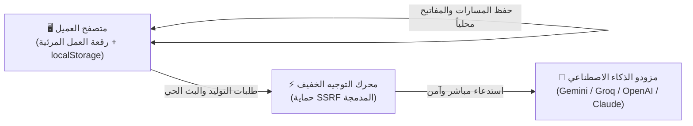

<div align="center" dir="rtl">

# ⚡ PF Studio

### بيئة مرئية مفتوحة المصدر لهندسة وتشغيل سلاسل الذكاء الاصطناعي
**محلية 100% • خصوصية تامة • بدون قواعد بيانات أو تسجيل دخول**

<br/>

[](LICENSE)
[](https://nextjs.org)
[](https://react.dev)
[](https://reactflow.dev)
[](#-لماذا-pf-studio)
[](#-لماذا-pf-studio)
[](https://www.typescriptlang.org)

<br/>

[**🚀 البدء السريع**](#-البدء-السريع-quick-start) •
[**💡 نبذة عن المشروع**](#-نبذة-عن-المشروع) •
[**🧩 أنواع العقد (20 عقدة)**](#-أنواع-العقد-المتوفرة-20-عقدة) •
[**🧠 النماذج المدعومة**](#-النماذج-المدعومة) •
[**English Summary**](#-english-overview) •
[**📄 الترخيص**](#-الترخيص-license)

</div>

---

<div dir="rtl">

## 💡 نبذة عن المشروع

منصة **PF Studio** هي أداة بصرية متقدمة ومفتوحة المصدر لتصميم، ربط، واختبار مسارات الذكاء الاصطناعي التفاعلية عبر رقعة عمل مرئية لا نهائية (**Node-Based Canvas**):

| الميزة | التفاصيل | القيمة العملية |
| :--- | :--- | :--- |
| 🔒 **خصوصية كاملة** | المعالجة والحفظ حصرياً داخل متصفحك (`localStorage`) | لا توجد أي خوادم أو قواعد بيانات تطلع على بياناتك أو مساراتك. |
| ⚡ **تشغيل فوري** | استنساخ وتشغيل خلال 30 ثانية دون أي متطلبات خادم | صفر إعدادات، صفر اشتراكات، وبدون Docker أو برامج مساعدة. |
| 🤖 **تعدد النماذج** | دعم مباشر لنماذج Google Gemini و Imagen 3 و Groq و OpenAI و Claude | دمج وتنسيق النماذج النصية والبصرية في مسار عمل واحد متكامل. |
| 💾 **تصدير سهل** | حفظ ومشاركة أي مسار عمل كملف `workflow.json` مستقل | تنزيل المسار بنقرة واحدة واستيراده على أي جهاز في ثوانٍ. |

---

## 🚀 البدء السريع (Quick Start)

شغّل المشروع محلياً على جهازك في **دقيقة واحدة**:

```bash
# 1. استنساخ المستودع
git clone https://github.com/RaadDev/pf-studio.git
cd pf-studio

# 2. تثبيت الحزم
npm install

# 3. التشغيل المحلي
npm run dev
```

افتح **[http://localhost:3000](http://localhost:3000)** في متصفحك؛ الرقعة جاهزة للعمل مباشرة!

> [!TIP]
> **إضافة المفاتيح (BYOK):** ضع مفتاحك في ملف `.env.local` باسم `GEMINI_API_KEY="مفتاحك_هنا"`، أو أضفه مباشرة بنقرة واحدة من أيقونة المفاتيح 🔑 في شريط الأدوات العلوي. المفاتيح تُشفّر وتُحفظ حصرياً داخل متصفحك.

---

## 🏛️ مخطط المعمارية المحلية (100% Local-First)



---

## 🧩 أنواع العقد المتوفرة (20 عقدة)

تم بناء **PF Studio** بنظام عقد معياري يغطي كافة متطلبات بناء تطبيقات الذكاء الاصطناعي:

| المجال | الأيقونة | أنواع العقد المتوفرة | الوظيفة والميزات الأساسية |
| :--- | :---: | :--- | :--- |
| **المدخلات وسحب البيانات** | 📥 | • إدخال نصي (`TextInput`)<br>• بحث ويب مباشر (`WebSearch`)<br>• رفع مستندات (`FileUpload`)<br>• سحب روابط وتفريغ يوتيوب (`UrlScraper`) | إدخال نصوص وأوامر مخصصة، بحث مباشر على محركات البحث، رفع ملفات محلياً (`TXT`, `MD`, `CSV`, `JSON`)، وسحب محتوى المواقع وتفريغ نصوص فيديوهات يوتيوب مع حماية SSRF كاملة. |
| **المعالجة والذكاء الاصطناعي** | 🤖 | • توليد النصوص (`TextAI`)<br>• محول اللهجات والأسلوب (`ToneRewriter`)<br>• توليد الصور (`ImageAI`)<br>• التحقق من كائنات JSON (`StructuredOutput`) | توليد ذكي فائق السرعة عبر Gemini Flash مع البث الحي وميزة "العصا السحرية"، محول اللهجات (سعودية بيضاء، خليجية، فصحى، أسلوب قصصي)، توليد صور سينمائية عبر Imagen 3 و Flux، والتحقق الصارم من JSON Schema. |
| **المنطق والتحكم** | ⚙️ | • تفريع الشروط (`Conditional`)<br>• حلقات تكرارية (`BatchLoop`)<br>• استخراج الحقول (`JsonExtractor`)<br>• دمج المتغيرات (`TemplateMerge`)<br>• تقسيم النصوص (`Splitter`)<br>• مؤقت الانتظار (`Delay`) | تفريع مسار التنفيذ (`If / Else`)، معالجة القوائم تكرارياً خطوة بخطوة، دمج المتغيرات التفاعلية `{{input}}`، تقسيم وتجزئة المستندات الطويلة، وتنظيم معدل الاستدعاء لتجنب حدود الـ Rate Limits. |
| **المخرجات والتكامل** | 🚀 | • عرض النتيجة النهائية (`FinalResult`)<br>• تحويل النص إلى صوت (`AudioVoice`)<br>• خطافات الويب (`WebhookOutput`)<br>• طلبات REST API الحية (`HttpRequest`) | معاينة مخرجات Markdown كاملة وتصديرها كملفات PDF أو JSON أو صور، تحويل النص إلى صوت ناطق بالعربية مباشرة عبر Web Speech API، وإرسال النتائج آلياً لأنظمة الأتمتة الخارجية (Zapier, Make, n8n, Slack). |

---

## 🧠 النماذج المدعومة

| المزود (Provider) | النماذج المدعومة (Supported Models) | السرعة والزمن | الاستخدام المثالي |
| :--- | :--- | :---: | :--- |
| **Google AI** | **Gemini 3.8 Flash** (الافتراضي السريع)<br>**Gemini 3.1 Pro** (استدلال متقدم)<br>**Google Imagen 3** (توليد الصور) | ⚡ ~200ms<br>🧠 استدلال عميق<br>🎨 دقة 4K | **الخيار الافتراضي الموصى به:** توليد النصوص، معالجة اللغة العربية، تحليل الأكواد، وتوليد صور إعلانية وفنية فائقة الدقة. |
| **Meta / Groq** | **Llama 3.3 70B** | ⚡ 250+ كلمة/ثانية | استدلال فائق السرعة عبر وحدات معالجة LPUs للنماذج المفتوحة المصدر. |
| **OpenAI** | **GPT-4o**<br>**GPT-4o Mini** | 🚀 استجابة سريعة<br>⚡ خفيف واقتصادي | المهام متعددة الوسائط، التفكير المنطقي المركب، والصياغة الإبداعية. |
| **Anthropic** | **Claude 3.5 Sonnet** | 👑 متوازن ودقيق | هندسة البرمجيات الدقيقة، مراجعة الأكواد، والصياغة الأدبية التعبيرية. |

---

## 📱 ميزة وضع التطبيق (App Mode)

بنقرة واحدة على أيقونة التطبيق في شريط الأدوات العلوي، يتحول المخطط المرئي المعقد إلى **واجهة مستخدم ويب بسيطة للعميل النهائي**:
* جمع كافة عقد الإدخال في بطاقات نموذج أنيقة ومنظمة.
* زر تشغيل رئيسي ينفذ كامل السلسلة في الخلفية.
* عرض النتيجة المكتملة بصيغة Markdown وصور تفاعلية دون إظهار الأسلاك أو التعقيدات التقنية.

</div>

---

<div dir="ltr">

## 🌐 English Overview

**PF Studio** is a modern, open-source, and 100% Local-First Visual AI Workflow Canvas.  
Build, test, and automate production-grade prompt chains and multi-modal pipelines with zero databases and zero mandatory logins.

```bash
git clone https://github.com/RaadDev/pf-studio.git
cd pf-studio
npm install
npm run dev
```

* 🔒 **100% Private:** Workflows, keys, and session data live exclusively in browser storage (`localStorage`).
* ⚡ **Instant Setup:** No Docker, no databases, no cloud setup. Clone and start building in under 60 seconds.
* 🤖 **Multi-Provider AI:** Google Gemini (3.8 Flash & Pro), Imagen 3, Groq (Llama 3.3), OpenAI (GPT-4o), and Anthropic (Claude 3.5 Sonnet).
* 💾 **Export & Share:** Download and share any pipeline as a standalone `.json` file with one click.

</div>

---

<div dir="rtl">

## 📄 الترخيص (License)

المشروع مرخص تحت رخصة **[MIT License](LICENSE)** المفتوحة المصدر.

<br/>

<div align="center">
  <sub>صُنع بكل ❤️ بواسطة <a href="https://github.com/RaadDev">RaadDev</a> للمطورين وصناع المحتوى حول العالم.</sub>
</div>

</div>