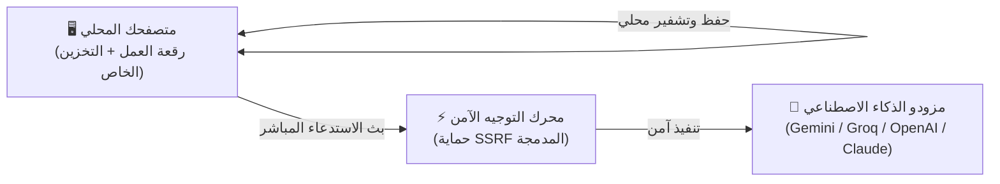

<div align="center" dir="rtl">

# ⚡ استوديو بي إف — PF Studio

### منصة بصرية مفتوحة المصدر لتصميم وتشغيل سلاسل الذكاء الاصطناعي
**محلية 100% • خصوصية تامة • بدون قواعد بيانات أو خوادم سحابية**

<br/>

[](LICENSE)
[](https://nextjs.org)
[](https://react.dev)
[](https://reactflow.dev)
[](#-الميزات-الرئيسية)
[](https://www.typescriptlang.org)

<br/>

[**🚀 البدء السريع**](#-البدء-السريع) •
[**✨ الميزات**](#-الميزات-الرئيسية) •
[**🧩 العقد الـ 20**](#-أنواع-العقد-20-عقدة) •
[**🧠 النماذج**](#-النماذج-المدعومة) •
[**❓ الأسئلة الشائعة**](#-الأسئلة-الشائعة) •
[**📄 الترخيص**](#-الترخيص)

</div>

---

<div dir="rtl">

## ✨ الميزات الرئيسية

| الميزة | الوصف الفني | الأهمية العملية |
| :--- | :--- | :--- |
| 🔒 **خصوصية محلية 100%** | تُحفظ المسارات والمفاتيح حصرياً في المتصفح (`localStorage`) | بياناتك ومفاتيحك لا تغادر جهازك لأي خادم مركزي. |
| ⚡ **تشغيل في 30 ثانية** | `git clone` ثم `npm run dev` دون أي إعداد مسبق | صفر قواعد بيانات، صفر خوادم مصادقة، وصفر اشتراكات. |
| 🤖 **ذكاء متعدد النماذج** | دعم مباشر لـ Gemini Flash، Imagen 3، Groq، GPT-4o، و Claude | دمج النصوص وتوليد الصور واستخراج الأكواد في مسار واحد. |
| 📱 **وضع التطبيق (App Mode)** | تحويل المخطط المرئي إلى واجهة مستخدم مبسطة للعميل | تشغيل المسار وإدخال البيانات دون إظهار الأسلاك والتعقيدات. |
| 💾 **تصدير واستيراد فوري** | تنزيل وحفظ أي مسار كملف `workflow.json` خفيف | مشاركة مسارات العمل وفتحها بضغطة زر على أي جهاز. |

---

## 🚀 البدء السريع

شغّل الاستوديو محلياً على جهازك في **3 خطوات**:

```bash
# 1. استنساخ المستودع
git clone https://github.com/RaadDev/pf-studio.git
cd pf-studio

# 2. تثبيت الحزم
npm install

# 3. التشغيل
npm run dev
```

افتح الرابط **[http://localhost:3000](http://localhost:3000)** في متصفحك؛ الرقعة جاهزة للعمل فوراً.

> [!TIP]
> **إضافة المفاتيح (BYOK):**  
> ضع مفتاحك في ملف `.env.local` باسم `GEMINI_API_KEY="مفتاحك_هنا"`، أو أضفه مباشرة من زر المفاتيح 🔑 في الشريط العلوي للاستوديو.

---

## 🏛️ معمارية التدفق المحلي



---

## 🧩 أنواع العقد (20 عقدة)

تم توزيع العقد لتغطية دورة عمل الذكاء الاصطناعي بالكامل:

| المجال | العقد المتوفرة | الوظيفة الأساسية |
| :--- | :--- | :--- |
| **📥 المدخلات والبيانات** | • إدخال نصي (`TextInput`)<br>• بحث ويب حي (`WebSearch`)<br>• رفع مستندات (`FileUpload`)<br>• تفريغ روابط ويوتيوب (`UrlScraper`) | استقبال الأوامر، البحث الحي على الإنترنت، قراءة ملفات (`CSV, JSON, TXT`)، وتفريغ نصوص مقاطع يوتيوب مع حماية أمنية من الـ SSRF. |
| **🤖 المعالجة والذكاء الاصطناعي** | • توليد نصوص (`TextAI`)<br>• محول اللهجات والأسلوب (`ToneRewriter`)<br>• توليد الصور (`ImageAI`)<br>• مخرجات دقيقة (`StructuredOutput`) | توليد سريع مع بث مباشر وميزة العصا السحرية، تكييف النبرة (سعودية، خليجية، فصحى)، توليد صور سينمائية عبر Imagen 3، وضمان كائنات JSON دقيقة. |
| **⚙️ المنطق والتحكم** | • تفريع شرطي (`Conditional`)<br>• حلقات تكرارية (`BatchLoop`)<br>• استخراج الحقول (`JsonExtractor`)<br>• دمج القوالب (`TemplateMerge`)<br>• تجزئة النصوص (`Splitter`)<br>• مؤقت الانتظار (`Delay`) | مسارات `If / Else`، معالجة القوائم تكرارياً، دمج المتغيرات `{{input}}`، تقسيم وتجزئة المقالات، وتنظيم معدل الاستدعاء لتجنب حدود الـ Rate Limits. |
| **🚀 المخرجات والتكامل** | • النتيجة النهائية (`FinalResult`)<br>• تحويل النص لصوت (`AudioVoice`)<br>• خطافات الويب (`WebhookOutput`)<br>• طلبات REST API الحية (`HttpRequest`) | معاينة Markdown وتصدير النتائج (PDF / JSON / صور)، نطق صوتي عربي عبر المتصفح، والربط المباشر مع أنظمة الأتمتة (Make, Zapier, n8n, Slack). |

---

## 🧠 النماذج المدعومة

| المزود | النموذج | السرعة | الاستخدام المثالي |
| :--- | :--- | :---: | :--- |
| **Google AI** | **Gemini 3.8 Flash** (الافتراضي)<br>**Gemini 3.1 Pro**<br>**Google Imagen 3** | ⚡ فائق السرعة (~200ms)<br>🧠 استدلال عميق<br>🎨 دقة 4K | معالجة اللغة العربية، تلخيص المحتوى، البرمجة، وتوليد صور إعلانية عالية الدقة. |
| **Meta / Groq** | **Llama 3.3 70B** | ⚡ 250+ كلمة/ث | استدلال فائق السرعة عبر وحدات معالجة LPUs للنماذج المفتوحة المصدر. |
| **OpenAI** | **GPT-4o** • **GPT-4o Mini** | 🚀 سريع ومتعدد الوسائط | المهام المعقدة، التحليل المنطقي، وفهم البيانات المصورة. |
| **Anthropic** | **Claude 3.5 Sonnet** | 👑 متوازن ومتقن | صياغة أدبية احترافية وهندسة برمجيات دقيقة. |

---

## ❓ الأسئلة الشائعة

<details>
<summary><b>1. هل استخدام PF Studio مجاني؟</b></summary>
نعم، المشروع مفتوح المصدر 100% برخصة MIT، ويعتمد افتراضياً على Google Gemini Flash الذي يقدم حصة استخدام مجانية سخية عبر Google AI Studio.
</details>

<details>
<summary><b>2. أين تُحفظ مسارات العمل ومفاتيح الـ API؟</b></summary>
تُحفظ محلياً داخل متصفحك فقط عبر `localStorage`. لا توجد أي قواعد بيانات تحفظ عملك، ويمكنك تنزيل أي مسار كملف `workflow.json` لنقله لأي جهاز آخر.
</details>

<details>
<summary><b>3. هل يدعم النماذج المحلية بدون إنترنت (Ollama)؟</b></summary>
نعم، يمكنك استخدام عقدة `HttpRequestNode` وإرسال الطلبات إلى رابط خادمك المحلي مثل `http://localhost:11434/api/generate`.
</details>

---

## 📄 الترخيص

مرخص تحت رخصة **[MIT License](LICENSE)** المفتوحة المصدر.

<div align="center">
  <sub>صُنع بكل ❤️ بواسطة <a href="https://github.com/RaadDev">RaadDev</a> لمجتمع المطورين وصناع المحتوى.</sub>
</div>

</div>
