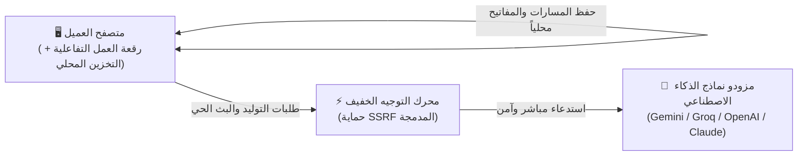

<div align="center" dir="rtl">

# ⚡ استوديو بي إف — PF Studio

### بيئة مرئية مفتوحة المصدر لهندسة وتشغيل سلاسل الذكاء الاصطناعي
**محلية 100% • خصوصية تامة • بدون قواعد بيانات أو تسجيل دخول**

<br/>

[](LICENSE)
[](https://nextjs.org)
[](https://reactflow.dev)
[](#)
[](#)
[](https://www.typescriptlang.org)
<br/>

<p align="center">
  <code>nextjs-16</code> •
  <code>react-19</code> •
  <code>reactflow</code> •
  <code>local-first</code> •
  <code>prompt-engineering</code> •
  <code>ai-workflow</code> •
  <code>gemini-3.8-flash</code> •
  <code>groq-llama</code> •
  <code>imagen-3</code> •
  <code>privacy-first</code> •
  <code>byok</code> •
  <code>open-source</code>
</p>

<br/>

[**🚀 البدء السريع**](#-البدء-السريع) •
[**💡 نبذة عن المشروع**](#-نبذة-عن-المشروع) •
[**🏛️ المعمارية المحلية**](#-مخطط-المعمارية-المحلية) •
[**🧩 العقد المتوفرة (20 عقدة)**](#-أنواع-العقد-المتوفرة-20-عقدة) •
[**🧠 النماذج المدعومة**](#-النماذج-المدعومة) •
[**📱 وضع التطبيق**](#-ميزة-وضع-التطبيق-app-mode) •
[**🏷️ الوسوم والتصنيف**](#️-وسوم-وتصنيفات-المستودع-about--topics) •
[**❓ الأسئلة الشائعة**](#-الأسئلة-الشائعة) •
[**📄 الترخيص**](#-الترخيص-license)

</div>

---

<div dir="rtl">

## 💡 نبذة عن المشروع

منصة **PF Studio** هي أداة بصرية متقدمة ومفتوحة المصدر لتصميم، ربط، واختبار مسارات الذكاء الاصطناعي التفاعلية عبر رقعة عمل مرئية لا نهائية (**Node-Based Canvas**):

| الميزة | التفاصيل | القيمة العملية |
| :--- | :--- | :--- |
| 🔒 **خصوصية كاملة** | المعالجة والحفظ حصرياً داخل متصفحك (`localStorage`) | لا توجد أي خوادم أو قواعد بيانات سحابية تطلع على بياناتك أو مساراتك. |
| ⚡ **تشغيل فوري** | استنساخ وتشغيل خلال 30 ثانية دون أي متطلبات خادم | صفر إعدادات، صفر اشتراكات، وبدون Docker أو قواعد بيانات معقدة. |
| 🤖 **تعدد النماذج** | دعم مباشر لنماذج Google Gemini و Imagen 3 و Groq و OpenAI و Claude | دمج وتنسيق النماذج النصية والبصرية في مسار عمل واحد متكامل. |
| 💾 **تصدير سهل** | حفظ ومشاركة أي مسار عمل كملف `workflow.json` مستقل | تنزيل المسار بنقرة واحدة واستيراده على أي جهاز في ثوانٍ. |

---

## 🚀 البدء السريع

شغّل المشروع محلياً على جهازك في **دقيقة واحدة**:

```bash
# 1. استنساخ المستودع
git clone https://github.com/RaadDev/pf-studio.git
cd pf-studio

# 2. تثبيت الحزم البرمجية
npm install

# 3. تشغيل خادم التطوير المحلي
npm run dev
```

افتح الرابط **[http://localhost:3000](http://localhost:3000)** في متصفحك؛ الرقعة جاهزة للعمل فوراً!

> [!TIP]
> **إضافة مفاتيح الذكاء الاصطناعي (احضر مفتاحك الخاص - BYOK):**  
> يمكنك وضع مفتاحك في ملف `.env.local` باسم `GEMINI_API_KEY="مفتاحك_هنا"`، أو إدخاله مباشرة وبكل سهولة من أيقونة المفاتيح 🔑 في شريط الأدوات العلوي. يتم تشفير المفاتيح وحفظها حصرياً داخل متصفحك.

---

## 🏛️ مخطط المعمارية المحلية

تعمل المنصة بنظام محلي بالكامل لحماية الخصوصية وتوفير أقصى سرعة استجابة:



---

## 🧩 أنواع العقد المتوفرة (20 عقدة)

تم بناء **PF Studio** بنظام عقد معياري متكامل يغطي كافة متطلبات هندسة الأوامر والأتمتة:

| المجال | الأيقونة | أنواع العقد المتوفرة | الوظيفة والميزات الأساسية |
| :--- | :---: | :--- | :--- |
| **المدخلات وسحب البيانات** | 📥 | • إدخال نصي (`TextInput`)<br>• بحث ويب مباشر (`WebSearch`)<br>• رفع مستندات (`FileUpload`)<br>• تفريغ روابط ويوتيوب (`UrlScraper`) | إدخال نصوص وأوامر مخصصة، بحث مباشر على محركات البحث، رفع ملفات محلياً (`TXT`, `MD`, `CSV`, `JSON`)، وسحب محتوى المواقع وتفريغ نصوص فيديوهات يوتيوب مع حماية SSRF كاملة. |
| **المعالجة والذكاء الاصطناعي** | 🤖 | • توليد النصوص (`TextAI`)<br>• محول اللهجات والأسلوب (`ToneRewriter`)<br>• توليد الصور (`ImageAI`)<br>• التحقق من كائنات JSON (`StructuredOutput`) | توليد ذكي فائق السرعة عبر Gemini Flash مع البث الحي وميزة "العصا السحرية"، محول اللهجات (سعودية بيضاء، خليجية، فصحى، أسلوب قصصي)، توليد صور سينمائية عبر Imagen 3 و Flux، والتحقق الصارم من JSON Schema. |
| **المنطق والتحكم** | ⚙️ | • تفريع الشروط (`Conditional`)<br>• حلقات تكرارية (`BatchLoop`)<br>• استخراج الحقول (`JsonExtractor`)<br>• دمج المتغيرات (`TemplateMerge`)<br>• تقسيم النصوص (`Splitter`)<br>• مؤقت الانتظار (`Delay`) | تفريع مسار التنفيذ (`If / Else`)، معالجة القوائم تكرارياً خطوة بخطوة، دمج المتغيرات التفاعلية `{{input}}`، تقسيم وتجزئة المستندات الطويلة، وتنظيم معدل الاستدعاء لتجنب حدود الـ Rate Limits. |
| **المخرجات والتكامل** | 🚀 | • عرض النتيجة النهائية (`FinalResult`)<br>• تحويل النص إلى صوت (`AudioVoice`)<br>• خطافات الويب (`WebhookOutput`)<br>• طلبات REST API الحية (`HttpRequest`) | معاينة مخرجات Markdown كاملة وتصديرها كملفات PDF أو JSON أو صور، تحويل النص إلى صوت ناطق بالعربية مباشرة عبر Web Speech API، وإرسال النتائج آلياً لأنظمة الأتمتة الخارجية (Zapier, Make, n8n, Slack). |

---

## 🧠 النماذج المدعومة

| المزود | النماذج المدعومة | السرعة والزمن | الاستخدام المثالي |
| :--- | :--- | :---: | :--- |
| **Google AI** | **Gemini 3.8 Flash** (الافتراضي السريع)<br>**Gemini 3.1 Pro** (استدلال متقدم)<br>**Google Imagen 3** (توليد الصور) | ⚡ ~200ms<br>🧠 استدلال عميق<br>🎨 دقة 4K | **الخيار الافتراضي الموصى به:** توليد النصوص، معالجة اللغة العربية، تحليل الأكواد، وتوليد صور إعلانية وفنية فائقة الدقة. |
| **Meta / Groq** | **Llama 3.3 70B** | ⚡ 250+ كلمة/ثانية | استدلال فائق السرعة عبر معالجات LPUs للنماذج المفتوحة المصدر. |
| **OpenAI** | **GPT-4o**<br>**GPT-4o Mini** | 🚀 استجابة سريعة<br>⚡ خفيف واقتصادي | المهام متعددة الوسائط، التفكير المنطقي المركب، والصياغة الإبداعية. |
| **Anthropic** | **Claude 3.5 Sonnet** | 👑 متوازن ودقيق | هندسة البرمجيات الدقيقة، مراجعة الأكواد، والصياغة الأدبية التعبيرية. |

---

## 📱 ميزة وضع التطبيق (App Mode)

بنقرة واحدة على أيقونة التطبيق في شريط الأدوات العلوي، يتحول المخطط المرئي المعقد إلى **واجهة مستخدم ويب بسيطة للعميل النهائي**:
* جمع كافة عقد الإدخال في بطاقات نموذج أنيقة ومنظمة على اليمين.
* زر تشغيل رئيسي ينفذ كامل السلسلة في الخلفية.
* عرض النتيجة المكتملة بصيغة Markdown وصور تفاعلية على اليسار دون إظهار الأسلاك أو التعقيدات التقنية.

---

## 🏷️ وسوم وتصنيفات المستودع (About & Topics)

لتحقيق أفضل ظهور للمشروع على GitHub وجذب المطورين والمهتمين بالذكاء الاصطناعي، يوصى باستخدام البيانات التالية في إعدادات المستودع (**Repository Settings ➔ About**):

### 📝 وصف المستودع (Description)
```text
⚡ بيئة مرئية مفتوحة المصدر 100% محلية لهندسة وتشغيل سلاسل الذكاء الاصطناعي التفاعلية عبر المتصفح دون الحاجة لقواعد بيانات أو تسجيل دخول.
```

### 🏷️ الوسوم الموصى بها (GitHub Topics)
```text
nextjs, react, reactflow, ai, llm, prompt-engineering, workflow-automation, visual-programming, local-first, privacy, gemini, groq, llama, imagen-3, openai, anthropic, typescript, open-source, arabic, byok
```

---

## ❓ الأسئلة الشائعة

<details>
<summary><b>1. هل استخدام PF Studio مجاني تماماً؟</b></summary>
نعم، المشروع مفتوح المصدر بنسبة 100% ومرخص تحت رخصة MIT. النموذج الافتراضي المعتمد هو Google Gemini 3.8 Flash الذي يوفر حصة استخدام مجانية سخية عبر Google AI Studio.
</details>

<details>
<summary><b>2. أين يتم حفظ مسارات العمل ومفاتيح الـ API؟</b></summary>
تُحفظ كافة مسارات العمل والمفاتيح محلياً داخل متصفحك عبر `localStorage`. لا توجد قواعد بيانات سحابية تحفظ بياناتك، ويمكنك تنزيل مسارك كملف `workflow.json` لنقله لأي جهاز آخر بأمان تام.
</details>

<details>
<summary><b>3. هل يدعم المشروع تشغيل النماذج المحلية (مثل Ollama)؟</b></summary>
نعم، يمكنك استخدام عقدة طلبات الـ REST API المباشرة (`HttpRequestNode`) وتوجيه الرابط إلى خادمك المحلي مثل `http://localhost:11434/api/generate` للربط مع Ollama أو LM Studio بدون إنترنت.
</details>

---

## 📄 الترخيص (License)

المشروع مرخص تحت رخصة **[MIT License](LICENSE)** المفتوحة المصدر.

<br/>

<div align="center">
  <sub>صُنع بكل ❤️ بواسطة <a href="https://github.com/RaadDev">RaadDev</a> للمطورين وصناع المحتوى حول العالم.</sub>
</div>

</div>
