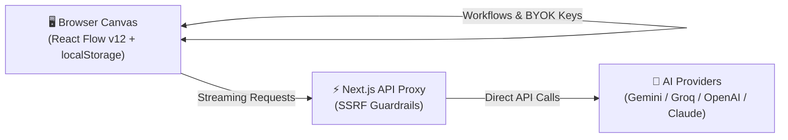

# ⚡ PF Studio

<div align="center">

### Modern • Minimalist • 100% Local-First Visual AI Workflow Canvas

Build, test, and automate production-grade AI prompt chains directly in your browser.  
**Zero Cloud Databases • Zero Tracking • Instant Plug & Play**

<br/>

[](LICENSE)
[](https://nextjs.org)
[](https://react.dev)
[](https://reactflow.dev)
[](#-architecture)
[](#-architecture)
[](https://www.typescriptlang.org)

<br/>

[**🚀 ابدأ الآن (Quick Start)**](#-quick-start) •
[**✨ الميزات (Features)**](#-core-features) •
[**🧩 العقد الـ 20 (Nodes)**](#-visual-nodes-catalog) •
[**🧠 النماذج (Models)**](#-supported-ai-models) •
[**🇸🇦 الدليل بالعربية**](#-دليل-الاستخدام-السريع-بالعربية) •
[**❓ الأسئلة الشائعة**](#-faq)

</div>

---

## 💡 Why PF Studio?

```
┌───────────────────────────────────────────────────────────────────────────────┐
│                                                                               │
│   🔒 100% Local & Private       ⚡ Instant Zero-Setup       🤖 Multi-Model    │
│   All workflows, keys, &        Clone & run in 30 seconds.  Gemini, Imagen 3, │
│   data live in your browser.    No Docker, DB, or logins.   Groq, GPT-4o,     │
│   Zero tracking, ever.          Pure client-side power.     Claude 3.5 Sonnet │
│                                                                               │
└───────────────────────────────────────────────────────────────────────────────┘
```

---

## 🚀 Quick Start

Get your visual AI studio running locally in under **60 seconds**:

```bash
# 1. Clone the repository
git clone https://github.com/RaadDev/pf-studio.git
cd pf-studio

# 2. Install dependencies
npm install

# 3. (Optional) Set your free Gemini API key
echo GEMINI_API_KEY="your_api_key_here" > .env.local

# 4. Start the studio
npm run dev
```

Open **[http://localhost:3000](http://localhost:3000)** in your browser — your canvas is ready!

> [!TIP]
> **BYOK (Bring Your Own Key):** You can also add or switch API keys directly from the **Keys 🔑** button in the canvas header. All keys are encrypted and saved solely inside your browser.

---

## 🏛️ Architecture

PF Studio follows a strictly **Local-First** design (inspired by Excalidraw and ComfyUI):



---

## ✨ Core Features

* 🔒 **Local-First Privacy:** Zero cloud database dependency. All workflows are persisted in `localStorage` or downloaded as clean `.json` files.
* 🧩 **20 Specialized Visual Nodes:** Covers everything from raw text and web scraping to multi-modal AI generation, logic loops, and webhooks.
* 📱 **Instant "App Mode":** Turn any complex visual graph into a clean, simple web form for non-technical users with one click.
* 🧪 **Automated Testing Lab:** Run test suites with output assertions (Regex, Strict Match, Valid JSON) and latency benchmarks.
* 🌐 **Native Arabic & RTL:** Built-in Dagre auto-layout optimized for Right-to-Left (RTL) Arabic text as well as standard LTR.
* 📊 **5-Tab Observability Console:** Real-time visibility into Logs, Outputs, Diagnostics, Inputs, and Execution Latency.

---

## 🧩 Visual Nodes Catalog (20 Nodes)

| Category | Node Name | Icon | What it does |
| :--- | :--- | :---: | :--- |
| **Input** | `TextInputNode` | 📝 | Raw prompt entry, character counter, and instant presets. |
| | `WebSearchNode` | 🌐 | Live web search with query customization and snippet extraction. |
| | `FileUploadNode` | 📁 | In-browser file loader (`TXT`, `MD`, `CSV`, `JSON`, `PY`). |
| | `UrlScraperNode` | 🔗 | Web scraping & **YouTube video transcript extraction** via oEmbed. |
| **AI Intelligence** | `TextAINode` | 🤖 | Core LLM generation with streaming and the **AI Magic Wand**. |
| | `ToneRewriterNode` | 🗣️ | Dialect adapter (Saudi White, Khaleeji, Formal Arabic, Storytelling). |
| | `ImageAINode` | 🎨 | High-resolution image synthesis (Google Imagen 3 & Flux.1). |
| | `StructuredOutput` | 📋 | Strict `JSON Schema` validation for deterministic outputs. |
| **Logic & Flow** | `JsonExtractorNode`| 🔍 | Parses unstructured text into syntax-highlighted JSON fields. |
| | `SplitterNode` | ✂️ | Splits text/data by lines, paragraphs, commas, or custom regex. |
| | `BatchLoopNode` | 🔁 | Steps through list elements sequentially with index tracking. |
| | `ConditionalNode` | 🔀 | Branching `If / Else` router based on text contents or length. |
| | `TemplateMergeNode`| 🧩 | Interpolates upstream variables using reactive `{{input}}` tags. |
| | `DelayNode` | ⏱️ | Flow rate regulator and countdown timer (1s to 30s). |
| **Testing & Media** | `TestAssertionNode`| 🧪 | Verifies outputs: Not Empty, Regex Match, Equals, Valid JSON. |
| | `NoteNode` | 📌 | Canvas sticky cards in 4 distinct themes for team notes. |
| | `AudioVoiceNode` | 🎙️ | Text-to-Speech (TTS) using Web Speech API with Arabic voice support. |
| **Outputs** | `FinalResultNode` | 🏁 | Markdown presentation view with PDF, MD, and image export. |
| | `WebhookOutputNode`| ⚡ | HTTP payload dispatcher (Zapier, Make, n8n, Slack, Telegram). |
| | `HttpRequestNode` | 📡 | Live REST API client (`GET`, `POST`, `PUT`, `DELETE`) with SSRF shield. |

---

## 🧠 Supported AI Models

| Model | Provider | Type | Latency | Context | Best For |
| :--- | :--- | :---: | :---: | :---: | :--- |
| **Gemini 3.8 Flash** | Google AI | Text | ⚡ ~200ms | 1M tokens | **Default:** Ultra-fast reasoning & Arabic tasks |
| **Gemini 3.1 Pro** | Google AI | Text | 🧠 Deep | 2M tokens | Complex architectures & long documents |
| **Google Imagen 3** | Google AI | Image | 🎨 ~3s | 4K HD | Commercial photography & creative artwork |
| **Llama 3.3 70B** | Meta / Groq | Text | ⚡ 250+ t/s | 128k | Near-instant open-source inference |
| **GPT-4o / Mini** | OpenAI | Multi | 🚀 Fast | 128k | Cross-modal logic & general tasks |
| **Claude 3.5 Sonnet**| Anthropic | Code | 👑 Balanced| 200k | Software engineering & nuanced writing |
| **Flux.1 Schnell** | BFL | Image | ⚡ ~2s | 1024x1024 | Fast visual drafts & accurate in-image text |

---

<div dir="rtl">

## 🇸🇦 دليل الاستخدام السريع بالعربية

### ما هو PF Studio؟
**PF Studio** هو بيئة تطوير وتصميم مرئية مفتوحة المصدر لبناء سلاسل وأوامر الذكاء الاصطناعي (AI Prompt Chains) على رقعة عمل مرئية لا نهائية مباشرة في المتصفح.

### لماذا المعمارية المحلية (100% Local-First)؟
* 🔒 **خصوصية مطلقة:** لا توجد خوادم سحابية أو قواعد بيانات خارجية تسجل عملك، مساراتك ومفاتيحك تبقى في جهازك فقط (`localStorage`).
* ⚡ **تشغيل فوري:** استنسخ المستودع وشغّله في 30 ثانية بدون أي إعدادات معقدة.
* 💾 **حرية التصدير والاستيراد:** حمّل أي مسار كملف `workflow.json` واستورده على أي جهاز بضغطة زر.
* 📱 **وضع التطبيق (App Mode):** تحويل أي مسار معقد إلى واجهة ويب بسيطة وواضحة للعميل لتشغيل الأوامر دون رؤية الأسلاك والعقد.

</div>

---

## ❓ FAQ

<details>
<summary><b>1. هل استخدام PF Studio مجاني؟</b></summary>
نعم 100% مفتوح المصدر برخصة MIT. كما يعتمد افتراضياً على Google Gemini 3.8 Flash الذي يقدم حصة مجانية مباشرة من Google AI Studio.
</details>

<details>
<summary><b>2. أين يتم حفظ مسارات العمل ومفاتيح الـ API؟</b></summary>
تُحفظ جميع مسارات العمل والمفاتيح محلياً داخل متصفحك عبر `localStorage`. يمكنك أيضاً تصديرها كملفات `.json` ومشاركتها مع فريقك بكل أمان.
</details>

<details>
<summary><b>3. هل يدعم النماذج المحلية (Ollama)؟</b></summary>
نعم، يمكنك استخدام عقدة `HttpRequestNode` وإرسال الطلبات مباشرة إلى منفذ Ollama المحلي `http://localhost:11434/api/generate`.
</details>

---

## 📄 License

Distributed under the **MIT License**. See [`LICENSE`](LICENSE) for more information.

<div align="center">
  <sub>Built with ❤️ by <a href="https://github.com/RaadDev">RaadDev</a> for creators and AI engineers worldwide.</sub>
</div>